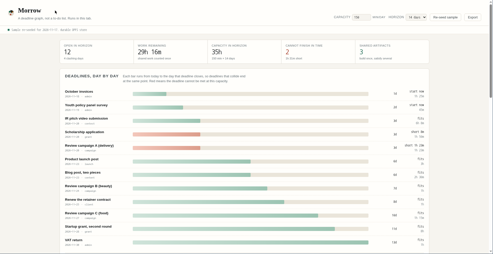

# Morrow

**A deadline graph, not a to-do list.** Nineteen deadlines, eighteen artifacts, and the one question a list cannot answer: *which single piece of work unblocks three of them?*

Open the app: **https://qkrrkdhzdl-arch.github.io/morrow/** — it runs in the tab, with no account, no server and no key.



---

## The use case

I am one person. In a normal fortnight I owe a pitch video, a scholarship form, three review campaigns, a grant application, a VAT return, a client proposal, a conference talk and a newsletter. The deadlines are not independent: the same pitch deck feeds the video and the talk, one photo set serves three campaigns, the portfolio is claimed by the scholarship and the award entry, and the bank certificate is the only thing standing between me and two very different cheque payments.

Every to-do app shows these as nineteen rows. That view is wrong in two directions at once:

- It **over-counts** work. Three campaigns need the same photo set; a list says "photos" three times and makes the week look impossible.
- It **hides the real blockage**. The 20-minute bank certificate is claimed by two deadlines worth $9,200 and is invisible until it is too late.

Morrow keeps the relationships as relationships. Each `Obligation` is a deadline with its own cost in minutes. Each `Artifact` is something that has to exist (a document, a photo set, a recording, a dataset). `NEEDS` carries the share of that artifact a deadline actually requires; `DEPENDS_ON` says an artifact cannot start until another one exists. The screen then answers three questions: which deadlines cannot be met at this capacity, which artifacts pay for themselves several times, and what a missing artifact drags in when you finally start it.

The sample graph is a real fortnight — mine, with the names generalised. `seed/sample.json` is the source; every date is an offset from the day you open the app, so it stays current.

## How it uses Relate

**Mode: WebAssembly in a dedicated worker, durable through OPFS** — and a **directory store** in this repository for inspection.

Two stores, one graph:

| Store | Where | Why |
|---|---|---|
| `opfs://morrow` | the browser, via `@relate/relate-wasm` in a worker | the deadlines and drafts belong to the person using it; a hosted copy of this app should never be the owner of that data. The store survives reloads, and nothing leaves the tab |
| `store/morrow/` | this repository, built by the Relate CLI with `--snapshot-format json` | a judge should be able to open the same graph without a browser, with `relate -d store/morrow -c "..."` |

**Why Relate rather than SQLite or a JSON file.** The questions this app asks are traversals, and three of them are the whole product:

1. *Which artifact is claimed by two or more open deadlines?* — `MATCH (o:Obligation)-[n:NEEDS]->(a:Artifact)` grouped over the paths, not a join over three tables.
2. *If I finish this artifact, what else does each waiting deadline still need?* — two hops out and back: artifact ← deadline → sibling artifacts.
3. *What has to exist before this can start?* — variable-length `DEPENDS_ON*1..3`, both directions.

On top of that, the search box in the assistant combines a vector index and a traversal **in one statement**: nearest artifacts by meaning, then the deadlines that claim them, so "have I written something like this proposal before?" returns the artifact *and* who is waiting on it.

```cypher
MATCH (a:Artifact)
SEARCH a IN (VECTOR INDEX artifact_brief FOR $vec LIMIT $k) SCORE AS score
MATCH (o:Obligation)-[:NEEDS]->(a)
WHERE o.status = 'open'
RETURN a.title, round(score, 3), collect(DISTINCT o.title) ORDER BY score DESC
```

Relate features in use: uniqueness constraints, a 128-dimension cosine vector index, a full-text index, `SEARCH`, variable-length paths, aggregation over distinct paths, parameterised writes (`CREATE`, `SET`), `executeScript` for the schema, the WASM build on the page, and the OPFS store in a worker. `SHOW INDEXES` on the checked-in store lists both indexes.

## Setup and run

No build step, no bundler, no dependencies to install.

```bash
git clone https://github.com/qkrrkdhzdl-arch/morrow
cd morrow
python3 -m http.server 8000
# open http://127.0.0.1:8000/
```

The first load writes the sample graph into the browser store (about eighty parameterised statements, under a second). Nothing is sent anywhere. `Re-seed sample` rebuilds it; `Export` downloads the graph as JSON.

To inspect the same graph without a browser:

```bash
# install the CLI once: https://relatedb.ai/docs/get-started/install
relate -d store/morrow -c "MATCH (n) RETURN labels(n), count(*)"
relate -d store/morrow -c "MATCH (o:Obligation)-[:NEEDS]->(a:Artifact) RETURN o.title, a.title LIMIT 5"
```

To rebuild the store from the generator, and to check that every statement the app runs also runs in the CLI:

```bash
python3 scripts/build_seed.py
bash scripts/build_store.sh                      # needs the relate CLI
RELATE_BIN=$(which relate) python3 scripts/verify_queries.py
```

## Where the data lives

| Path | What it is |
|---|---|
| `store/morrow/` | the persistent directory store (WAL + `graph.json` snapshot). This is the store to point the CLI at |
| `seed/seed.cypher` | the same graph as Cypher, generated by `scripts/build_seed.py` |
| `seed/sample.json` | the sample the browser loads: offsets in days, and the 128-dimension vectors |
| `cypher/queries.json` | every statement the app sends, in one file — the app fetches it, and `scripts/verify_queries.py` runs it against `store/morrow` |
| `cypher/schema.cypher` | constraints and indexes, shared by the CLI build and the app |

## What is computed where

The split is deliberate and is shown in the app's Cypher log, so no number is a black box:

- **Cypher** answers the graph questions: what claims what, what is shared, what is downstream, what is similar, what a change would drag in. Every one of those statements is in `cypher/queries.json`.
- **`assets/planner.js`** answers the arithmetic question a graph cannot: given a capacity per day, can this work actually be placed in the days that remain? It is earliest-deadline-first, and it counts a shared artifact **once**, for the earliest deadline that claims it. That single rule is the difference between "the week is impossible" and "the week is fine if I shoot the photos first".
- **The assistant** (`assets/agent.js`) may only choose among six tools. It never sends Cypher, so a bad completion can pick the wrong question but cannot rewrite the answer. Writes (`mark_ready`, `add_deadline`) stop at an in-page confirmation before they touch the graph.

## Limits, stated

- The embedder is a 128-dimension hashed character-trigram vector, not a trained model: it matches wording and morphology, not meaning in the way a sentence-transformer would. It was chosen so that the first paint needs no download and no key. `docs/EMBEDDING.md` has the trade-off and the measurement.
- The planner is a greedy schedule, not an optimiser. It will not reshuffle deadlines to squeeze in one more; it tells you the shortfall and stops.
- One person, one graph, one browser. Relate is single-process by design and this app does not pretend otherwise: two tabs share one OPFS store, and the second tab sees the first tab's writes on reload, not live.
- The sample is a sample. `add_deadline` and `mark_ready` are the only editing paths; there is no import from a calendar, and deleting a deadline is a Cypher statement in the log, not a button.

## Product capabilities, third-party tools and AI tools used

- **Relate by Neo4j 1.0.2** — WASM build (`@relate/relate-wasm`, vendored in `assets/vendor/relate/`), OPFS durable store in a worker, Cypher 25, vector index, full-text index, constraints.
- **No other runtime dependency.** No framework, no CDN, no analytics, no fonts fetched at runtime. Vanilla ES modules and one SVG view drawn by hand.
- **AI in the build**: I used a coding assistant (Claude) to draft the CSS and to review the planner's scheduling logic; every Cypher statement was written and verified against the real CLI (`scripts/verify_queries.py`). The in-app assistant talks to whatever OpenAI-compatible endpoint the visitor configures; the app ships no key and costs the host nothing.
- **Data**: the sample graph is my own fortnight, with titles generalised. No third-party dataset.

## Licence

MIT. `assets/vendor/relate/` is the unmodified npm package (`@relate/relate-wasm` 1.0.2), which keeps its own Apache-2.0 licence.
